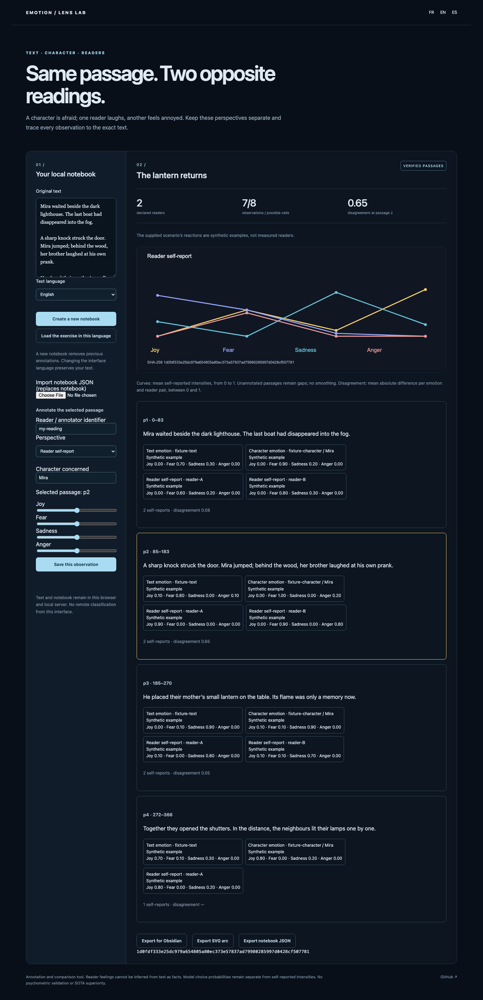

# Emotion Lens Lab

[Français](README.md) · [Español](README.es.md)

**Compare text emotion, character emotion and multiple readers’ self-reports without merging their perspectives.**

A paragraph can frighten a character, amuse one reader and annoy another. This notebook keeps attributed layers separate, exposes coverage gaps and compares reader disagreement. Every annotation retains an exact source span, observer and text fingerprint.

## Try it

Python 3.11+; no key or remote request for the demo.

```sh
git clone https://github.com/gbesse/emotion-lens-lab
cd emotion-lens-lab
python3 -m emotion_lens serve --lang en
```

Open `http://127.0.0.1:8771/?lang=en`. The original short story and **synthetic reactions** are an exercise, not collected human labels. At passage 2, a character is afraid while two fictional readers disagree: their mean absolute difference across four emotions is **0.65**. Seven of eight possible reader cells are observed; the gap remains visible.

Click a passage, enter intensities between 0 and 1 and save an observation. Changing interface language preserves text and document language; explicitly loading another exercise creates another notebook. Browser storage persists the notebook. Creating a new notebook removes previous annotations.

Export notebook JSON, SVG arcs and **Obsidian Markdown** with exact quotations, fingerprints and stable block anchors. No Obsidian plugin is required. Code generates Markdown and SVG; no model rewrites author text.

Importing notebook JSON also displays Jev annotations; importing explicitly replaces the previous notebook.



## Computation

Four self-reported intensities: joy, fear, sadness and anger; they need not sum to one. Reader means exclude text and character layers. Disagreement is the mean absolute difference over all four emotions and all reader pairs in a passage. Fewer than two readers means unknown disagreement. Identifiers do not verify identity, independence or sincerity.

Paragraph offsets use **Unicode codepoints**, not bytes or UTF-16 units; accents and emoji are tested. Text or span edits invalidate previous annotations instead of silently moving them. Curves do not connect across unannotated passages.

```sh
python3 -m emotion_lens demo --lang en
python3 -m emotion_lens analyze emotion_lens/examples/en.json
python3 -m emotion_lens markdown emotion_lens/examples/en.json --lang en > notebook.md
python3 -m emotion_lens svg emotion_lens/examples/en.json --lang en > arc.svg
```

`pip install .` also provides `emotion-lens`. FR/EN/ES UI, errors, examples and exports; user text is never automatically translated.

## Explicit Jev classification

```sh
pip install .
# Supply TYPESAFE_API_KEY through the environment; never put it in code.
python3 -m emotion_lens classify emotion_lens/examples/en.json > model-notebook.json
```

This sends at most three passages to `api.typesafe.ai`: **one paid request**, model `jev-1.13.0`, one `choice` question per passage. Library `classify(..., perspective="character", target="Mira", max_segments=3)` also supports character and reader-hypothesis perspectives. Hard limits: six passages and 18,000 request characters. Verified TLS, 30-second timeout, no redirects or retries. No paid calls from the browser.

Choices: joy, fear, sadness, anger, neutral, mixed, uncertain. **Choice probabilities are not emotion intensities.** Distributions and confidence remain a separate model layer, never reader self-reports. Invalid responses fail; the call does not overwrite human or synthetic reports.

[live-text-annotations.json](docs/live-text-annotations.json) records an actual trial on three original French passages: one request, 911 input and 206 output tokens; seven synthetic reader reports unchanged. This validates integration, not emotional accuracy. No key is published. Independent project; not affiliated with TypeSafe AI. [TypeSafe documentation](https://docs.typesafe.ai/primitives/choice).

## Comparisons and limits

[EmotionArcs](https://aclanthology.org/2024.latechclfl-1.7/) already publishes thousands of novel arcs. [read-with-jev](https://github.com/carlaiau/read-with-jev) already offers a reader, Jev emotional associations and a character map. This project claims neither the first emotional reader nor better classification. Its focus is **attributed perspectives, comparable reader reports, coverage gaps and exportable exact passages**.

Models cannot establish what a real reader feels. Character names are declared; pronouns are not resolved. Paragraphs may lack context. No psychometric validation, human-labelled corpus evaluation, diagnosis, literary quality measure or SOTA superiority. Local server only; no accounts, multiuser sync, PDF or EPUB.

## Verify

```sh
python3 -m unittest discover -s tests -v
npm ci
npx playwright install chromium
npm run test:browser
npm run format:check
```

Thirteen tests cover Unicode anchors, stale hashes, separate perspectives, arithmetic disagreement oracle, gaps, idempotent observations, exact exports and bounded provider validation. FR/EN/ES browser, editing, exports, text preservation, injection and mobile; Python 3.11/3.12 CI and installed wheel outside source. Tests do not call Jev. MIT; public alpha.
